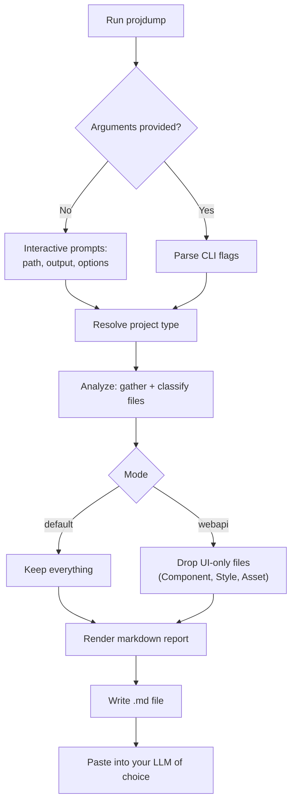
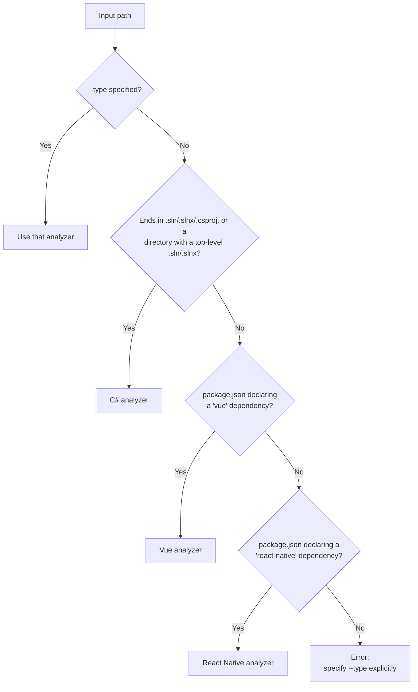

# projdump

A .NET CLI tool that distils a C# solution/project, a Vue project, or a React Native project into a single structured markdown file, making it easy to provide codebase context to an LLM.

- [What it does](#what-it-does)
- [Usage](#usage)
- [How it works](#how-it-works)
- [How project type is detected](#how-project-type-is-detected)
- [What gets excluded](#what-gets-excluded)
- [Building](#building)
- [Project structure](#project-structure)
- [Testing](#testing)
- [Adding a new project type](#adding-a-new-project-type)
- [Output structure](#output-structure)
- [Sample output](#sample-output)
- [Token estimate](#token-estimate)
- [License](#license)

## What it does

Point `projdump` at a C# solution/project (or a folder containing one), a Vue project, or a React Native project, and it produces a self-contained markdown document containing:

- **Project summary** — file extension breakdown table
- **Project structure** — full relative file tree
- **Documentation** — contents of any `.md` files found
- **Solution configuration** — the `.sln`/`.slnx` file itself (C# solutions only)
- **Project dependencies** — `.csproj` contents, or `package.json` for Vue and React Native
- **Configuration files** — `appsettings.json`, `vite.config.ts`, `metro.config.js`, `.env`, and other well-known config files
- **Scripts** — PowerShell, batch, and shell scripts (`.ps1`, `.bat`, `.cmd`, `.sh` and friends), root-level ones first
- **App code** — source files ordered by significance (entry points → routing/state → models → components → everything else)
- **Token estimate** — a rough token count in the header so you know if you're within context window budget before pasting

Scripts sit between configuration and app code on purpose: how a project is built, run, and deployed is usually more valuable context than any single source file, but less foundational than its configuration.

It supports three project types out of the box — C#, Vue, and React Native — and a focus **mode** that trims the report to a specific concern (currently a WebAPI mode for C#). Both are designed to be extended without touching the rest of the tool.

## Usage

```
projdump <path> [output-path] [options]
```

Run with no arguments at all for **interactive mode** — it'll prompt you for the path, output location, and options one at a time:

```
projdump
```

A few things interactive mode does differently from the plain CLI flags:

- **Offers to reuse a recent command first**, if you've saved any before.
- **Skips the mode question for solutions.** Point it at a `.sln`/`.slnx` and `--mode` won't be asked, since a mode applies per-project and a solution usually spans more than one.
- **Offers to save the command** once a run finishes successfully, so it shows up in the reuse list next time.

Saved commands live in `<ApplicationData>/projdump/command-history.json` (`%APPDATA%\projdump\command-history.json` on Windows) as a plain, append-only JSON array — nothing is ever rotated or capped, it just grows for as long as you keep saving. When the file has entries, interactive mode asks upfront whether to reuse one, then lists them most-recent-first for you to pick from; answering no (or there being no file yet) falls through to the normal prompts.

### Options

| Flag | Description |
| :--- | :--- |
| `--slim` | Omit file contents; list filenames and sizes only |
| `--exclude-tests` | Exclude test projects and test files |
| `--scope <dir>` | Restrict to a subdirectory, relative to the project root |
| `--exclude-dir <n>` | Exclude a directory by name, anywhere in the tree (repeatable) |
| `--find-readme` | Look in parent directories for a README when the project has none |
| `--type <csharp\|vue\|react-native>` | Force project type (auto-detected by default) |
| `--mode <default\|webapi>` | Report focus mode (`webapi` is C#-only for now) |
| `--help`, `-h` | Show usage |

### Examples

```bash
# Dump an entire solution — writes MyApp-app-solution.md alongside MyApp.sln
projdump MyApp.sln

# Dump a single project — writes MyApp.Api-app-project.md
projdump src/MyApp.Api/MyApp.Api.csproj

# Dump a Vue project — writes <package.json name>-app-project.md
projdump ./frontend

# Dump a React Native project — writes <package.json name>-app-project.md
projdump ./mobile

# Native source is included by default; drop it entirely if you only want the JS
projdump ./mobile --exclude-dir android --exclude-dir ios

# Write output to a specific file or directory
projdump MyApp.sln C:\context\myapp-context.md
projdump MyApp.sln C:\context\

# Skip tests, and scope to one project within a solution
projdump MyApp.sln --exclude-tests --scope src/MyApp.Api

# Focus the report on backend API surface (C# only)
projdump MyApp.Api.csproj --mode webapi

# --mode webapi already drops UI-only files (images, CSS) from wwwroot,
# but keeps hand-written JS since it might genuinely call the API - this
# drops wwwroot entirely instead, treating it as a separate UI concern
projdump MyApp.Api.csproj --mode webapi --exclude-dir wwwroot
```

The output filename is always `<project-name>-app-solution.md` or `<project-name>-app-project.md` (plus `-slim` if that flag is set) — the project name comes from the `.sln`/`.csproj` file name for C#, or the `name` field in `package.json` for Vue and React Native. The same name is used as the report's heading. If you don't give an output path, the report is written to your **Desktop** by default (falling back to the project's own folder if a Desktop folder can't be resolved on the current platform).

## How it works



## How project type is detected

If `--type` isn't given, `projdump` tries each supported project type in turn until one claims the input:



C# is checked first, so if a directory somehow contains both a solution file and a JS `package.json` at the same level, the C# analyzer wins. Pointing at a directory only looks one level deep for a solution file (not recursively) — if there's more than one `.sln`/`.slnx` directly in it, that's ambiguous and `projdump` will ask you to point at the exact file instead of guessing.

Vue and React Native both key off `package.json`, but on mutually exclusive dependencies, so their relative order doesn't matter. The distinguishing dependency for the React family is `react-dom` (web) versus `react-native` (mobile) — the `react` package alone appears in both and tells you nothing. The check is for the exact package name, so `react-native-reanimated` and similar libraries don't accidentally claim a web project. Note that plain React **web** isn't supported yet; it falls through to the error.

### Expo Router

React Native projects using [Expo Router](https://docs.expo.dev/router/introduction/) have no root `App.tsx` — routes live in a file-based tree under `app/` or `src/app/`, and `main` points at `expo-router/entry`. When `expo-router` is a declared dependency and one of those folders exists, `projdump` adapts:

- The routing root's own `_layout` file is treated as the app entry point.
- Nested `_layout` files sort ahead of their sibling routes, since they define the navigator shape.
- Everything under the routing root is tagged as routing surface rather than as a plain component.

Without `expo-router`, an `app/` folder is treated as an ordinary directory.

## What gets excluded

To keep the output clean and token-efficient, the following are always skipped:

| Category | Examples |
| :--- | :--- |
| Build artifacts (C#) | `bin/`, `obj/` |
| Build output (Vue) | `dist/` |
| Auto-generated code (C#) | `*.designer.cs`, `*.g.cs`, `*.g.i.cs` |
| Boilerplate (C#) | `AssemblyInfo.cs`, `GlobalUsings.cs` |
| Minified assets (any stack) | `*.min.js`, `*.min.css` |
| EF Core migrations (C#) | `Migrations/` |
| VCS / editor / agent config | `.git/`, `.vscode/`, `.vs/`, `.idea/`, `.claude/`, `.cursor/` |
| Dependencies | `node_modules/`, `package-lock.json`, `yarn.lock`, `pnpm-lock.yaml` |
| Native build output (RN) | `android/build/`, `android/app/build/`, `.gradle/`, `ios/build/` |
| Native dependencies (RN) | `ios/Pods/`, `Podfile.lock`, `Gemfile.lock` |
| Generated project state (RN) | `*.xcodeproj/`, `*.xcworkspace/`, `.expo/`, `gradle/wrapper/`, `*.icon/` |
| Packager output (RN) | `*.bundle`, `*.jsbundle` |
| Machine-specific / secrets (RN) | `local.properties`, `*.keystore` |
| Template boilerplate (RN) | `reset-project.js`, `.tsc-output.txt` |
| Gradle wrapper scripts (RN) | `gradlew`, `gradlew.bat` |

With `--exclude-tests`, these are also dropped: `Tests/`, `Test/`, `Specs/`, `UnitTests/`, `IntegrationTests/`, `__tests__/`, `__mocks__/`, `__snapshots__/`, `e2e/` folders, plus `*Tests.cs`, `*Spec.cs`, `*.spec.ts`, `*.test.js` and similar naming conventions.

Hand-written native source in a React Native project is deliberately **kept** — `MainActivity.kt`, `AppDelegate.mm`, `Info.plist`, `build.gradle`, and `Podfile` all survive, since they carry permissions, bundle IDs, and native module wiring. Only build output and vendored dependencies are dropped. If you want the native projects gone entirely, `--exclude-dir android --exclude-dir ios` does it.

With `--mode webapi`, files get one more layer of filtering on top of the above: anything tagged `Component`, `Style`, or `Asset` (XAML/Razor views, CSS, and images/fonts) is dropped, since it's UI concern rather than API surface. Hand-written JavaScript under something like `wwwroot/js` is deliberately *not* dropped by this — it might genuinely be relevant to how the API gets called, and there's no reliable way to tell "hand-written" from "vendored" by role alone. If you want the whole thing gone regardless, `--exclude-dir wwwroot` removes it entirely, no matter what's in it. Scripts are not filtered by `webapi` — a deploy or migration script describes how the API runs, so it stays regardless of mode.

## Building

Requires the [.NET 10 SDK](https://dotnet.microsoft.com/download) or later.

```bash
git clone https://github.com/your-username/projdump.git
cd projdump
dotnet build
```

Run directly (the solution has several projects, so `dotnet run` needs to know which one):

```bash
dotnet run --project projdump.Terminal -- MyApp.sln
```

Or publish a self-contained executable:

```bash
dotnet publish projdump.Terminal -c Release -r win-x64 --self-contained
```

Run the test suite:

```bash
dotnet test
```

## Project structure

```
projdump.slnx
projdump.Engine/           # analysis, filtering, and rendering — no console I/O
  Core/                    # ProjectAnalysis model, registry, extension points
  Analyzers/               # one folder per supported project type, plus AnalyzerCatalog
  Modes/                   # report-focus filters (default, webapi)
  Rendering/               # markdown generation
projdump.Shared/           # cross-cutting infra usable by any front end (command history)
projdump.Terminal/         # the CLI shell — argument parsing, prompts, console output
projdump.Engine.Tests/     # NUnit tests for projdump.Engine
projdump.Shared.Tests/     # NUnit tests for projdump.Shared
projdump.Terminal.Tests/   # NUnit tests for projdump.Terminal
```

`projdump.Engine` has no dependency on the console — it's a plain class library, so a future GUI front end could reference it directly instead of `projdump.Terminal`. `projdump.Shared` follows the same idea for things a GUI would also want, like the saved-command history — it depends on nothing except the .NET base class library.

`Core` deliberately knows nothing about any concrete stack. The list of shipped analyzers lives in `Analyzers/AnalyzerCatalog.cs` instead, which builds a `ProjectTypeRegistry` for the CLI to consume.

## Testing

Three NUnit projects, one per assembly:

- `projdump.Engine.Tests` — classifiers, exclusion filters, the registry, modes, the renderer
- `projdump.Shared.Tests` — command history load/save
- `projdump.Terminal.Tests` — argument parsing, filename sanitization, the interactive prompt flow, and end-to-end runs through `Program.Execute`

```bash
dotnet test
```

Most of the suite is small, isolated unit tests with no file system involved — `FileInfo` objects built from plain strings, fake implementations of the internal filter/detector interfaces, that kind of thing. A smaller set are integration tests, used only where the code genuinely can't avoid touching disk: the renderer reads file content and size directly, the analyzers walk a real directory tree, and `Program.Execute` is the actual pipeline end to end. Those use a `TempProjectDirectory` helper (one per test project) that creates a unique temp folder and deletes it on `Dispose`, so `using var temp = new TempProjectDirectory();` at the top of a test guarantees cleanup even if an assertion fails partway through.

A few things worth knowing if you're adding tests:

- Most of what's tested (`CSharpFileClassifier`, the exclusion filters, `FormatHelpers`, etc.) is `internal`, not `public` — each project grants its test project access via `InternalsVisibleTo` rather than widening the public API just for testing.
- Never pass a bare relative path (`new FileInfo("Foo.cs")`) into a path-segment check. It resolves against the test runner's working directory, typically a build output path like `bin/Debug/net10.0/`, which itself contains segments like `bin` that these filters look for — silent false positives depending on where the repo happens to live. Use `TestSupport/FakePaths.Combine(...)` in `projdump.Engine.Tests`, which anchors the path under the OS temp directory instead — and make sure it's a genuinely *absolute* path, not just a relative one with an extra folder tacked on, since a relative path still inherits the CWD regardless of what you prepend to it.
- Classifiers that vary per project (currently `ReactNativeFileClassifier`) are instance classes, constructed with the project root and, for Expo Router projects, the routing root. Tests build one instance per scenario rather than calling static methods.
- Interactive mode's prompt flow (`PromptForOptions`, `TryUseSavedCommand`, `OfferToSaveCommand`) *is* covered, via a `ConsoleInputScope` helper in `projdump.Terminal.Tests` that scripts `Console.ReadLine()` answers for a test. One subtlety: `Console.ReadLine()` returns `null` (not an exception) once the scripted input runs out, so a test with too few queued answers can accidentally "pass" even when the code being tested is broken — queue a recognizable sentinel value as the next answer if you want to prove a question was genuinely *skipped* rather than just running out of input. What isn't covered is `RunInteractive`/`Main` as one integrated flow (reuse → prompt → execute → save) — each piece is tested individually instead.
- Two features write outside the project being dumped: the Desktop-default output path, and the command history file under `%APPDATA%`. Both have a test-only static override on `Program` (`DefaultOutputDirectoryOverride`, `CommandHistoryFilePathOverride`) with a matching `IDisposable` scope class, so tests never touch your real Desktop or your real saved-command history.
- Records with a collection-typed field (like `SavedCommand.ExcludeDirs`, typed `IReadOnlyList<string>`) can't be compared with `Is.EqualTo` across a serialization round-trip — the list is a new instance each time, and collection types don't override `Equals` for structural comparison, so record equality silently falls back to reference equality on that field. Compare fields individually instead, using `Is.EquivalentTo` for the collection field.

## Adding a new project type

Every project type implements one interface:

```csharp
public interface IProjectAnalyzer
{
    string TypeKey { get; }                              // e.g. "csharp", "vue"
    string DisplayName { get; }                          // readable label for prompts and help text
    IReadOnlyCollection<string> SupportedModes { get; }   // which report modes this type supports

    bool CanHandle(string inputPath);                     // "could this input plausibly be my type?"

    // Validates the input, gathers and classifies files. Throws ProjectAnalysisException for bad input.
    ProjectAnalysis Analyze(string inputPath, ProjectAnalysisOptions options);
}
```

To add support for a new stack:

1. Create `Analyzers/<YourType>/<YourType>Analyzer.cs` implementing `IProjectAnalyzer`, including a `TypeKey` (what the user types, e.g. `react-native`) and a `DisplayName` (what help text shows, e.g. `React Native`).
2. Write a `CanHandle` check (extension, marker file, folder contents — whatever identifies your stack).
3. In `Analyze`, gather files and tag each one with a `FileRole` (`EntryPoint`, `ApiSurface`, `Component`, etc.) — that's what lets report modes filter intelligently without knowing anything about your stack.
4. Call `AncestorReadmeLocator.AddNearestReadme(readmeFiles, inputFileInfo.Directory, options.SearchForReadme)` after gathering, so your type gets the same README handling as the others for free. Pass the *input file's* directory rather than `rootDir` — `--scope` reassigns `rootDir`, which would move where the ancestor walk starts.
5. Gather scripts with `ScriptFileClassifier.IsScriptFile` and order them with `ScriptFilePriority` — shell and automation scripts look the same in every ecosystem, so there's nothing stack-specific to write.
6. Add it to `Analyzers/AnalyzerCatalog.cs`. That's the only registration point — the CLI derives its `--type` list, interactive prompt, and help text from the registry, so nothing else needs editing.

Alongside the analyzer, most stacks want three companions in the same folder: a `<YourType>ExclusionFilter` for build output and dependencies, a `<YourType>TestFileDetector` for that ecosystem's test conventions, and a `<YourType>FileClassifier` holding the role assignment and code-ordering rules. Compose the filters with the shared ones in `Core/Filters/` rather than duplicating them.

One trap worth knowing: anchor entry-point names to the project root. In JS ecosystems `index.ts` is also the standard barrel-file convention, so an unanchored name match tags every `src/components/index.ts` as an application entry point.

The renderer, the mode system, and the CLI/interactive layer are all written against `ProjectAnalysis` and don't need to change for a new type to work.

## Output structure

```
# MyApp - App Solution

> Estimated tokens: ~12,400 _(character count ÷ 4 — treat as a rough guide)_

## Project Summary
## Project Structure
## Documentation
## Solution Configuration
## Project Dependencies
## Configuration
## Scripts
## App Code
```

(Vue and React Native projects skip the "Solution Configuration" section — there's no solution file — and "Project Dependencies" shows `package.json` instead of `.csproj` files.)

## Sample output

The first section or two of a real run against a small ASP.NET Core API, trimmed for length:

````markdown
# MyApp.Api - App Project

> **Estimated tokens:** ~8,214  _(character count ÷ 4 — treat as a rough guide)_

## Project Summary
| File Extension | Count |
| :--- | :--- |
| .cs | 14 |
| .json | 3 |
| .md | 1 |

## Project Structure
```text
MyApp.Api.csproj
Program.cs
appsettings.json
Controllers/OrdersController.cs
Models/Order.cs
Models/OrderDto.cs
Services/IOrderService.cs
Services/OrderService.cs
```

## Project Dependencies
### MyApp.Api.csproj
**Path:** `MyApp.Api.csproj`

```xml
<Project Sdk="Microsoft.NET.Sdk.Web">
  ...
</Project>
```

## App Code
### Program.cs
**Path:** `Program.cs`

```csharp
var builder = WebApplication.CreateBuilder(args);
...
```
````

## Token estimate

The estimate at the top of every output is calculated as `character count ÷ 4`, a reasonable heuristic for mixed code and prose across GPT and Claude tokenisers. Treat it as a ballpark — actual token counts will vary by model.

## License

MIT